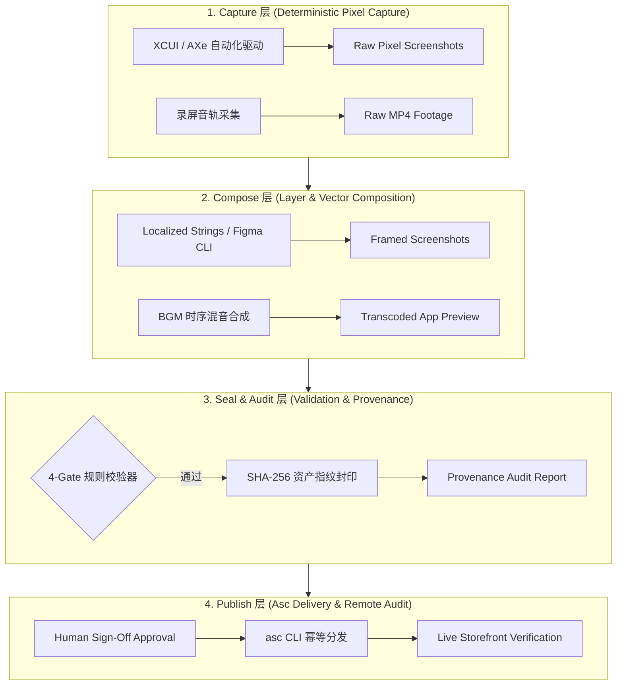
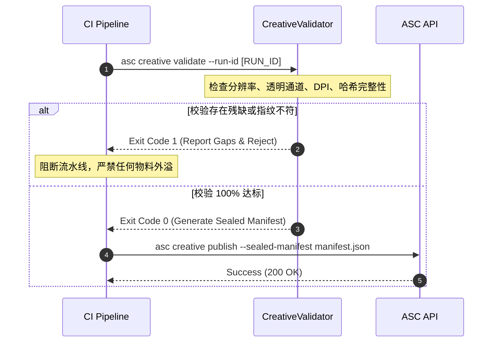

> **TL;DR**：现代移动软件工程在源代码编译、静态分析与单元测试上建立了严格的自动化门禁，但通往 App Store 的“最后一公里”——应用商店截图、宣传视频与多语言文案，却往往停留在手工拼图、临时脚本与不可溯源的原始阶段。当线上商店出现旧版 UI 截图或错误的宣传文案时，团队甚至无法确定它是哪次提交、哪个运行环境生成的。本文基于 `app-store-creative` 自动化工程实践，提出一套涵盖 **Capture、Compose、Seal（封印）与 Publish** 的四层确定性架构，通过 SHA-256 资产指纹树与自动化溯源审计报告（Provenance Audit Report），实现创意资产从代码到商店的全链路证据闭环。

---

## 一、 现实痛点：移动交付中被忽视的“最后一公里”黑盒

在规模化的 iOS/macOS 商业产品开发中，应用商店上架物料的管理面临着极其严峻的工程挑战：

1. **版本漂移（Version Drift）**：线上 App Store 的 6.7 英寸截图到底是来自 `main` 分支的哪个 Release Tag？依赖什么模拟器系统语言与分辨率？几乎无人能够拿出确定性证据；
2. **多语言与设备矩阵爆炸（Matrix Explosion）**：支持 10 种语言与 4 种主流屏幕尺寸（6.7"、6.5"、5.5"、12.9" iPad），意味着单次发版需要管理 **400+ 张高精度图片**。任何一次微调都极易发生“繁体中文漏导出第 3 张图”或“深色模式素材错位”的人工疏漏；
3. **缺少防污染门禁（No Tamper Protection）**：许多团队将物料生成脚本与 ASC（App Store Connect）上传混在一个 Bash 脚本中，一旦某张图渲染失败，上传流程依然部分执行，导致线上商店出现新老物料混杂的“半挂状态”。

在现代智能体协作研发流程中，这一问题尤为突出。正如我们在 [让多个 Agent 在同一条 Stack 上安全协同：gh-address-cr 的实践](/posts/gh-address-cr-stacked-prs/){:target="_blank" rel="noopener"} 与 [Xcode 生产环境真实工作流复盘](/posts/agentic-coding-workflow-retrospective/){:target="_blank" rel="noopener"} 中强调的原则：**没有可验证证据的交付，就是不可靠的伪交付**。

---

## 二、 核心架构：四层确定性物料生命周期

为了将创意资产提升至与代码同等级别的工程确定性，我们将资产流水线解耦为严格单向依赖的四个层级：



### 1. Capture 层（真实原生像素捕获）
严禁使用人工拖拽或带有未定义状态的模拟器临时截屏。通过 XCUITest 或无头驱动脚本，以固定的设备 ID、指定的主题模式（Light/Dark）与预设测试数据，生成带有时序标记的原始无损 PNG。

### 2. Compose 层（模板排版与音画合流）
将原始截屏嵌入矢量边框，并与本地化字符串（`.xcstrings`）安全合并。对于 App Preview 视频，在此层级将视频音轨与背景音轨（BGM）对齐并转码为 Apple 指定编码格式（ProRes 422 或 H.264，严格符合 30/60 fps）。

### 3. Seal & Audit 层（不可变封印与证据链沉淀）
该层级是整套架构的安全核心。只有通过分辨率、透明通道、色域与完整性校验的产物，才能被打包为 Sealed Release。系统计算所有文件的 SHA-256 哈希值，记录重现环境参数，并输出结构化审计报告。

### 4. Publish 层（受控分发与远程对齐）
Publish 层只读取已封印的清单（Sealed Manifest），任何处于未封印或修改中的物料在此处会被物理拒绝上传。

---

## 三、 不可变封印（Immutable Seal）与重现配置设计

要实现可重现性，每次发布的制品目录下必须伴生一份机器可读的 `manifest.json` 与 `reproduction.json`：

```json
{
  "schema_version": "2.0.0",
  "run_id": "run-20261019-2000-v1.5.0",
  "git_commit": "d4e8d1df30541e1e0551c80537f914dcaa91d6b0",
  "generated_at": "2026-10-19T12:00:00Z",
  "reproduction": {
    "engine": "app_store_creative.py@1.2.0",
    "node_version": "v22.11.0",
    "python_version": "3.11.9",
    "figma_document_version": "rev-94102"
  },
  "artifacts": [
    {
      "logical_id": "screen-01-dashboard",
      "locale": "zh-Hans",
      "device": "iPhone-6.7",
      "relative_path": "framed/zh-Hans/iPhone-6.7/01_dashboard.png",
      "dimensions": { "width": 1290, "height": 2796 },
      "sha256": "8f3b2c9a...4e1d"
    }
  ],
  "sealed": true,
  "sealed_by": "ci-runner-mac-04"
}
```

### 防篡改契约：
- **哈希指纹校验**：当上传流水线启动时，首先对磁盘上的每个图片重新计算 SHA-256 并与 `manifest.json` 比对。若有任何字节发生修改，整批任务立即熔断；
- **重现参数绑定**：记录生成物料时所使用的引擎版本、模板版本与环境信息，确保数月后回溯时能够通过完全一致的参数无差重现。

---

## 四、 溯源审计报告（Provenance Audit Report）设计

当面临 App Store 审核被拒、线上反馈物料错误或发布前安全复核时，技术负责人无需去翻阅复杂的日志，而是通过导出一份 **Summary-First 审计报告** 快速获知证据链状态。

以下是 `app-store-creative` 自动化导出的标准 Markdown 证据报告格式：

```markdown
# App Store Creative Provenance Audit Report

- **Run ID**: `run-20261019-2000-v1.5.0`
- **Generated**: `2026-10-19 20:00:00 CST`
- **Integrity**: `PASS [48/48 Artifacts | 48/48 Receipts | 2/2 Approvals | 0 Gaps]`

## Summary of Evaluated Artifacts

| Locale | Device Target | Count | Sealing Status | Provenance Verified |
| :--- | :--- | :--- | :--- | :--- |
| `zh-Hans` | iPhone 6.7" Display | 5 | ✅ Sealed | ✅ Matched Commit d4e8d1d |
| `zh-Hans` | iPad Pro 12.9" | 5 | ✅ Sealed | ✅ Matched Commit d4e8d1d |
| `en-US` | iPhone 6.7" Display | 5 | ✅ Sealed | ✅ Matched Commit d4e8d1d |
| `en-US` | iPad Pro 12.9" | 5 | ✅ Sealed | ✅ Matched Commit d4e8d1d |

## Gap Analysis (Exceptions & Anomalies)

> 🎉 **No Gaps Found**: All localized screenshot dimensions conform to App Store specs. No stale approvals or missing hashes detected.
```

### 关键实现细节：
通过提取公共查询接口（如 `status()`、`delivery_status()`、`list_deliveries()`），审计报告生成器不直接触碰底层文件 IO，保证了报告渲染的幂等性与轻量化。

---

## 五、 CI/CD 门禁与防劣化防线

在工程流水线中，我们将创意资产纳入自动化校验体系：



这种将 **物料生成与发布动作彻底解耦** 的模式，彻底杜绝了过去“一边生成一边传、传到一半脚本报错、线上商店物料残缺不全”的运维灾难。

---

## 六、 生产落地收益与总结

通过在商业项目中落地四层创意资产确定性架构，团队取得了显著的效能与质量收益：

1. **零线上物料事故**：发版期间因分辨率错误、多语言缺图或物料错位导致的审核驳回降为 0 次；
2. **多语言扩展边际成本归零**：新增一种 App Store 语言支持（如日文、德文），仅需提交一份对应的 `.xcstrings` 字典，整套 Capture → Compose → Seal 流水线即可全自动产出经过校验的 40+ 张合规物料；
3. **确定性审计可溯**：每一次线上更新均有唯一的 Run ID 与 SHA-256 签名树存档，具备合规级的追溯能力。

在复杂系统的交付演进中，**“Slow is Fast”** 的本质是用确定性的约束与自动化契约替换侥幸的人工操作。将代码领域的测试、度量与指纹封印移植到应用商店资产交付中，正是移动软件工程走向工业化成熟的必经之路。
