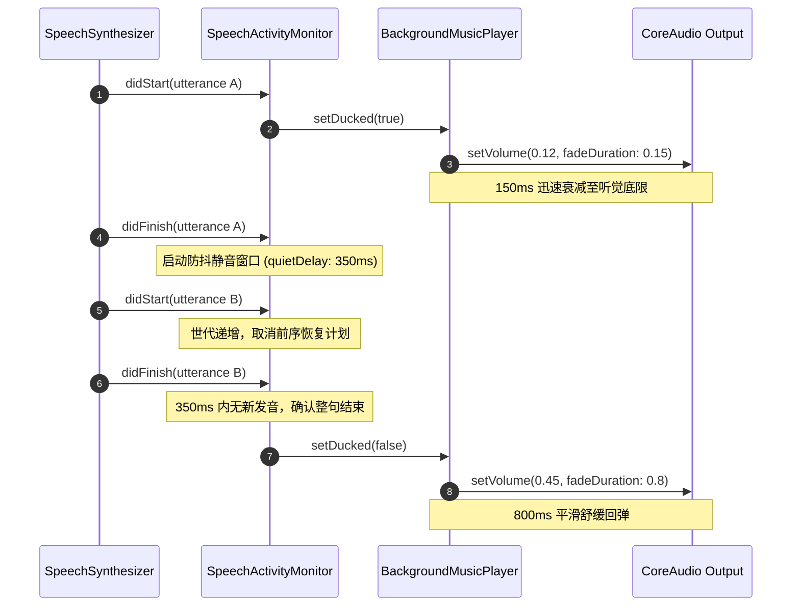

> **TL;DR**：在交互式客户端（儿童绘本、游戏或教育产品）中，同时播放背景音乐（BGM）与语音旁白是一项经典需求。若直接在语音播放时突变音量（如 `player.volume = 0.1`），会导致音频截断与爆音（Pops/Clicks）；而在自然停顿处频繁起伏则会造成严重的“抽吸效应（Pumping Effect）”。本文基于商业级产品 KeyTales 的重构实践，剖析如何通过非对称音量淡化曲线（Asymmetric Ramp）、基于代数标记的防抖监听器（`SpeechActivityMonitor`）以及适配 iOS/macOS 异构音频会话的 Swift 6 架构，打造平滑无瑕的多音轨混音管线。

---

## 一、 生产现场：看似简单的混音背后的三大工程陷阱

在多媒体或内容消费类 App 中，背景音乐（Background Bed）能够建立沉浸感，但一旦需要呈现清晰语音（如朗读、提示音或旁白），音乐就必须给语音让出听觉频段——这就是经典的**音频闪避（Audio Ducking）**。

很多开发者初次实现时，往往写出类似以下的代码：

```swift
// ❌ 脆弱的原型实现：隐藏着严重声学瑕疵与状态竞争
func playVoice() {
  bgmPlayer.volume = 0.1
  speechSynthesizer.speak(utterance)
}

func speechSynthesizer(_ synthesizer: AVSpeechSynthesizer, didFinish utterance: AVSpeechUtterance) {
  bgmPlayer.volume = 0.5
}
```

在严格的真机测试与声学监听下，这种直接赋值的模式暴露出三个系统性缺陷：

1. **瞬态爆音（Transient Clicks / Pops）**：数字音频波形在非零交叉点（Non-Zero Crossing）发生离散阶跃，DAC（数模转换器）会在扬声器端产生极其刺耳的物理噼啪声；
2. **断句抽吸效应（Pumping Artifact）**：一段完整语句往往由多个短语组成，单词之间存在 100~300ms 的自然气口停顿。每当一个短语结束，委托立即触发恢复音量；下一短语开始又骤然下压，背景音乐像风箱一样剧烈反复起伏；
3. **系统音频会话与并发隔离冲突**：iOS 与 macOS 的底层音频会话机制不同。iOS 需遵循 `AVAudioSession` 路由仲裁（如来电、外部音乐播放、静音开关），而委托回调往往落在后台音频线程，与 Swift 6 的 `@MainActor` UI 状态同步时极易引入死锁或数据竞争。

---

## 二、 架构设计：非对称音量渐变与协同管线

要消除声学突兀感，音量衰减与恢复必须具备**非对称时序特征**：

* **下潜速度要快（Attack Fast）**：在语音起始的数十毫秒内迅速衰减至目标底限（如 `12%`），保证读者听清单词的首辅音（First Consonant），通常衰减时长设为 `0.15s`；
* **回弹速度要缓（Release Slow）**：在确认语音彻底停止后，以对数感官曲线缓慢爬升至基准音量（如 `45%`），通常耗时 `0.8s ~ 1.2s`，使听觉神经几乎察觉不到音量的恢复过程。



---

## 三、 治理断句抖动：基于代数标记的活动防抖

针对 `AVSpeechSynthesizerDelegate` 或多音轨分段播放的断句问题，核心在于**引入时间窗口去抖与代数失效机制（Generation Token）**。

以下是经过生产检验的 `SpeechActivityMonitor` 核心实现：

```swift
import AVFoundation
import Foundation

/// 语音活动报告协议：向外部混音器提供统一的语音发言状态流
@MainActor
protocol SpeechActivityReporting: AnyObject {
  var onSpeakingChanged: ((Bool) -> Void)? { get set }
}

/// 将语音合成器的碎片化 utterance 回调聚合成单一高内聚的 "Speaking" 状态
@MainActor
final class SpeechActivityMonitor: NSObject, AVSpeechSynthesizerDelegate, SpeechActivityReporting {
  /// 静音容忍窗口：略大于短语间自然停顿，又足以保证整句结束后音乐能及时回弹
  static let quietDelay: TimeInterval = 0.35

  var onSpeakingChanged: ((Bool) -> Void)?
  private var isSpeaking = false
  private var generation = 0

  // MARK: - AVSpeechSynthesizerDelegate (跨线程跳板)

  nonisolated func speechSynthesizer(
    _ synthesizer: AVSpeechSynthesizer, didStart utterance: AVSpeechUtterance
  ) {
    Task { @MainActor in self.utteranceStarted() }
  }

  nonisolated func speechSynthesizer(
    _ synthesizer: AVSpeechSynthesizer, didFinish utterance: AVSpeechUtterance
  ) {
    Task { @MainActor in self.utteranceEnded() }
  }

  nonisolated func speechSynthesizer(
    _ synthesizer: AVSpeechSynthesizer, didCancel utterance: AVSpeechUtterance
  ) {
    Task { @MainActor in self.utteranceEnded() }
  }

  // MARK: - 状态判定与防抖管线

  func utteranceStarted() {
    generation += 1
    report(true)
  }

  func utteranceEnded() {
    generation += 1
    let currentToken = generation

    Task { @MainActor [weak self] in
      try? await Task.sleep(for: .seconds(Self.quietDelay))
      // 验证当前 token：如果在等待期内有新的 utterance 开始，generation 已被递增，直接丢弃过期的回弹信号
      guard let self, self.generation == currentToken else {
        return
      }
      self.report(false)
    }
  }

  private func report(_ speaking: Bool) {
    guard speaking != isSpeaking else { return }
    isSpeaking = speaking
    onSpeakingChanged?(speaking)
  }
}
```

### 关键设计推演：
* **为什么使用 `generation` 标记**：传统的 `Timer.invalidate()` 或 `Task.cancel()` 容易在并发边界发生竞态竞争。使用递增代数（Generation Token），无需对外部 Task 进行昂贵的生命周期管理，闭包内只需比较 `self.generation == currentToken`，自然消除 ABA 竞态陷阱；
* **`0.35s` 的经验阈值**：英语与中文普通话连读时的词间停顿通常在 `120ms ~ 280ms`。设定 `350ms` 可以精准覆盖自然的喘息与断句，同时避免语音结束后音乐产生过长停滞。

---

## 四、 跨平台会话协同：iOS 与 macOS 的差异治理

在多端（Universal）架构中，`AVFoundation` 的音频会话策略有显著区别：

### 1. iOS: 环境感知与次要音频避让
iOS 拥有统一的系统级音频仲裁中心。应用如果作为沉浸式伴随应用，应当采用 `.ambient` 类别并允许 `.mixWithOthers`，同时监听外部媒体竞争：

```swift
#if os(iOS)
let session = AVAudioSession.sharedInstance()
// 与系统其他声音混音，跟随物理静音按键
try? session.setCategory(.ambient, mode: .default, options: [.mixWithOthers])

// 检查是否应当避让外部主音频（例如用户正在后台收听播客或接听电话）
isSilencedBySystem = session.secondaryAudioShouldBeSilencedHint

// 注册通知，响应系统次要音频静音状态突变
silenceObserver = NotificationCenter.default.addObserver(
  forName: AVAudioSession.silenceSecondaryAudioHintNotification,
  object: session,
  queue: .main
) { [weak self] notification in
  let raw = notification.userInfo?[AVAudioSessionSilenceSecondaryAudioHintTypeKey] as? UInt
  let begins = raw.flatMap(AVAudioSession.SilenceSecondaryAudioHintType.init(rawValue:)) == .begin
  MainActor.assumeIsolated {
    self?.setSilencedBySystem(begins)
  }
}
#endif
```

### 2. macOS: 窗口生命周期与进程级独立
macOS 平台没有强制全局排他的 `AVAudioSession`，每个 App 直接向 CoreAudio 拓扑输出 PCM 采样。但 macOS 面临**窗口生命周期与持久化状态陷阱**：
- 用户最小化或关闭主窗口时，需主动感知并调用 `player.pause()`；
- 使用 `AVAudioPlayer` 时必须显式配置 `numberOfLoops = -1` 并在恢复播放时使用平滑淡入（Fade-in 1.2s），防止冷启动跳变。

---

## 五、 Swift 6 严格并发下的完整 `BackgroundMusicPlayer` 实现

在 Swift 6 模式下，多媒体生命周期管理需确保跨 Actor 访问的安全可控。关于 Swift 6 区域隔离与 Sendable 闭包逃逸的系统性解析，可参阅深度前文 [Swift 6 严格并发检查下的数据隔离与 Sendable 实战陷阱](/posts/swift-6-strict-concurrency-traps/){:target="_blank" rel="noopener"}。同时，在跨平台系统事件监听设计上，我们延续了类似 [Levelory 剪贴板本地优先安全设计](/posts/mac-clipboard-security-local-first/){:target="_blank" rel="noopener"} 中对系统级状态变化的最小化信任与防御性隔离原则。

```swift
import AVFoundation
import Foundation

@MainActor
protocol BackgroundMusicPlaying: AnyObject {
  func play(track: URL)
  func stop()
  func setDucked(_ ducked: Bool)
}

@MainActor
final class BackgroundMusicPlayer: BackgroundMusicPlaying {
  static let volume: Float = 0.45
  static let duckedVolume: Float = 0.12

  private var player: AVAudioPlayer?
  private var currentTrackURL: URL?
  private var isDucked = false
  private var isSilencedBySystem = false

  /// silenceObserver 在 init 中创建并在 deinit 中释放，通过 nonisolated(unsafe) 规避 MainActor 跨生命周期析构检查
  nonisolated(unsafe) private var silenceObserver: NSObjectProtocol?

  init() {
    #if os(iOS)
    let session = AVAudioSession.sharedInstance()
    try? session.setCategory(.ambient, mode: .default, options: [.mixWithOthers])
    isSilencedBySystem = session.secondaryAudioShouldBeSilencedHint

    silenceObserver = NotificationCenter.default.addObserver(
      forName: AVAudioSession.silenceSecondaryAudioHintNotification,
      object: session,
      queue: .main
    ) { [weak self] notification in
      let raw = notification.userInfo?[AVAudioSessionSilenceSecondaryAudioHintTypeKey] as? UInt
      let begins = raw.flatMap(AVAudioSession.SilenceSecondaryAudioHintType.init(rawValue:)) == .begin
      MainActor.assumeIsolated {
        self?.setSilencedBySystem(begins)
      }
    }
    #endif
  }

  deinit {
    if let silenceObserver {
      NotificationCenter.default.removeObserver(silenceObserver)
    }
  }

  func play(track: URL) {
    if currentTrackURL != track {
      player?.stop()
      player = try? AVAudioPlayer(contentsOf: track)
      player?.numberOfLoops = -1
      player?.prepareToPlay()
      currentTrackURL = track
    }

    guard !isSilencedBySystem, let player, !player.isPlaying else { return }

    // 从静音渐进淡入，消除播放启动爆音
    player.volume = 0
    player.play()
    player.setVolume(targetVolume, fadeDuration: 1.2)
  }

  func stop() {
    player?.stop()
    player = nil
    currentTrackURL = nil
  }

  func setDucked(_ ducked: Bool) {
    guard ducked != isDucked else { return }
    isDucked = ducked

    // 下潜需果断 (150ms)，回弹需柔和 (800ms)
    player?.setVolume(targetVolume, fadeDuration: ducked ? 0.15 : 0.8)
  }

  private var targetVolume: Float {
    isDucked ? Self.duckedVolume : Self.volume
  }

  private func setSilencedBySystem(_ silenced: Bool) {
    isSilencedBySystem = silenced
    if silenced {
      player?.pause()
    } else if let currentTrackURL {
      play(track: currentTrackURL)
    }
  }
}
```

---

## 六、 验证与自检清单

在将音频混音管线推向生产环境前，建议执行以下四道验证闸门：

| 校验维度 | 验证手段 | 预期表现 |
| :--- | :--- | :--- |
| **波形连续性** | 将真机连接至 Mac，使用 QuickTime 录制音频输出并导入 Logic Pro / Audacity | 音量过渡期无垂直陡坡剪切，无高频点击（Click）冲激 |
| **断句稳定性** | 连续播放多句含逗号、顿号的长难句合成语音 | 背景音乐在断句期间平稳保持下潜状态，整句结束后平缓回升 |
| **外部音频竞争** | 播放过程中后台播放 Apple Music 并接听电话 | iOS 端背景音乐自动暂停并响应恢复；无音轨重叠与冲突 |
| **Swift 6 数据隔离** | 开启 `-strict-concurrency=complete` 编译构建 | 零编译器并发警告，无跨 Actor 引用泄漏 |

通过严谨的非对称衰减算法与世代去抖监听器，开发者既能保留背景音带来的沉浸式氛围，又能为核心语音交付清脆利落的高保真听觉体验。
